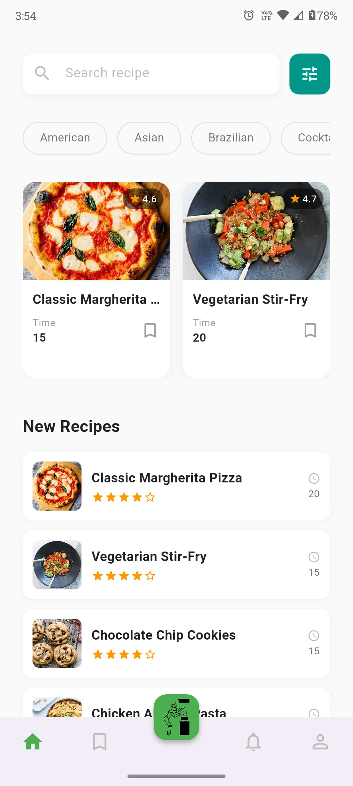
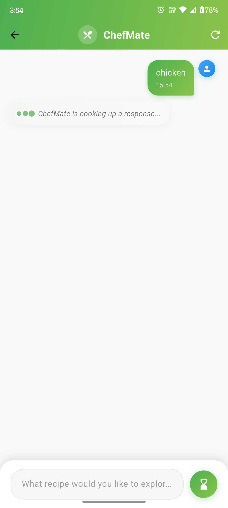
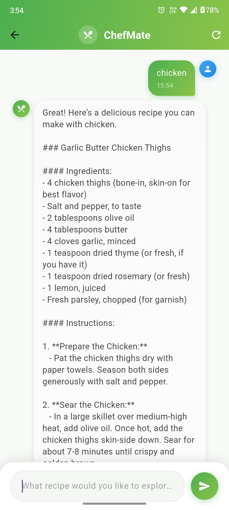

# ChefMate

AI recipe generator built with Flutter. Enter the ingredients you have at home and ChefMate generates a complete recipe using an LLM (GPT-4o mini).

## Screenshots

| Home | Ingredient input | Recipe output |
| :---: | :---: | :---: |
|  |  |  |

## Features

- **Ingredient-based recipes**: type what you have and get a full recipe with steps
- **Input validation**: non-food queries are rejected before calling the API
- **User accounts**: sign up and sign in with Firebase Authentication, profile data stored in Cloud Firestore

## Tech stack

| Area | Choice |
| --- | --- |
| Framework | Flutter |
| State management | Riverpod (`riverpod_annotation`) |
| Navigation | go_router |
| Networking | Dio |
| Models | Freezed + json_serializable |
| Backend | Firebase Auth, Cloud Firestore |
| AI | GPT-4o mini via AIMLAPI chat completions |

## Run locally

1. Clone and install:
   ```bash
   git clone https://github.com/sarmesh17/ChefMate.git
   cd ChefMate
   flutter pub get
   ```
2. Get an API key from [aimlapi.com](https://aimlapi.com).
3. Run the app with your key. The key is passed at build time and is never stored in the code:
   ```bash
   flutter run --dart-define=AIML_API_KEY=your_key
   ```
